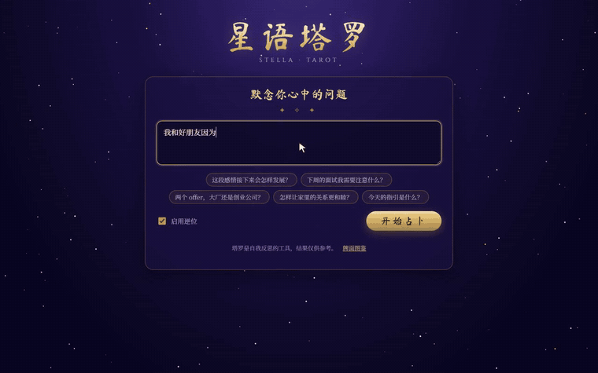
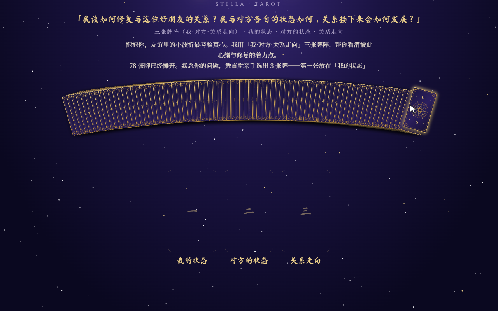
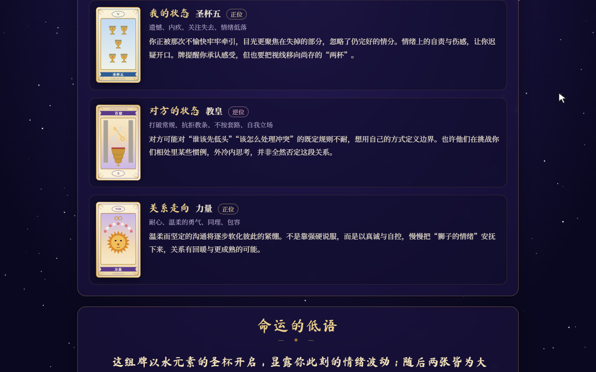
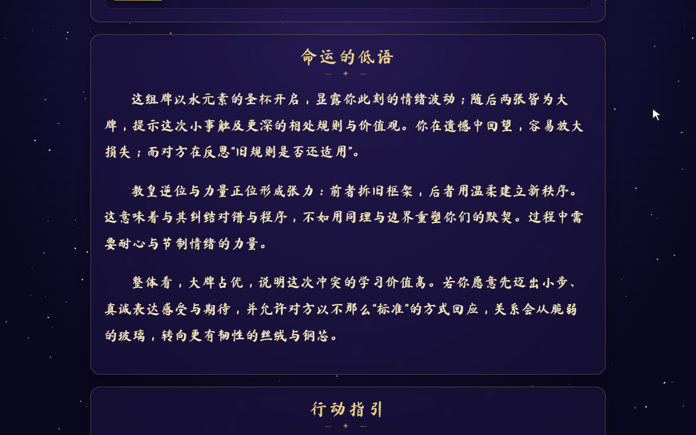
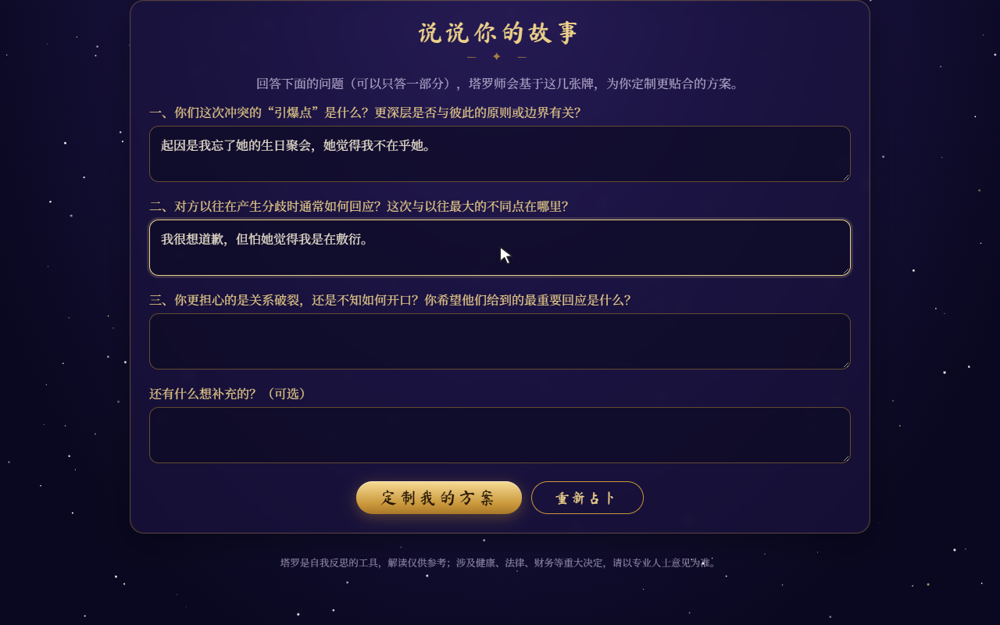
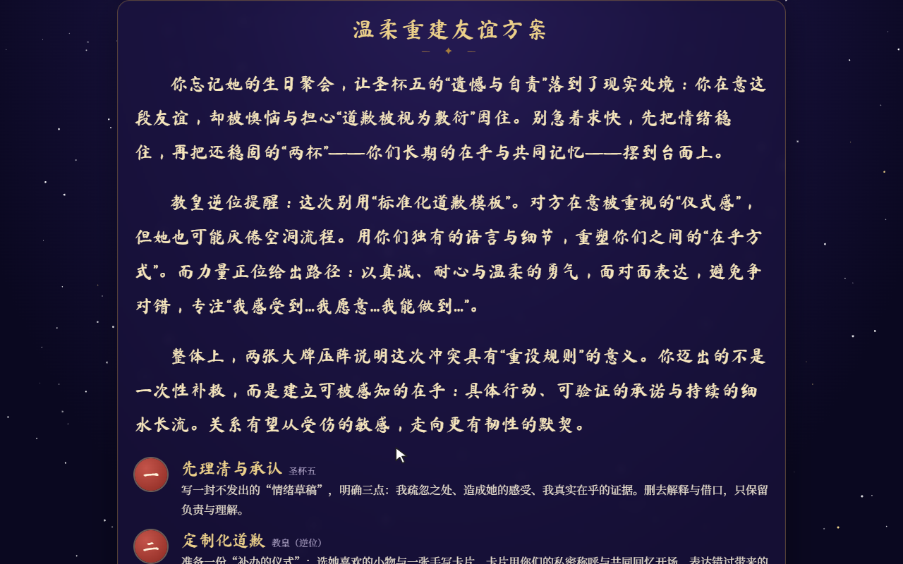
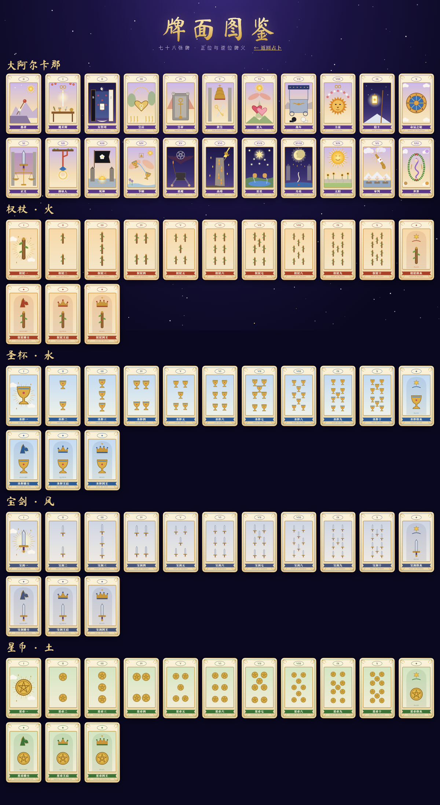
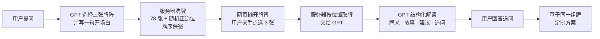

<div align="center">

# 🔮 星语塔罗 · Stella Tarot

**真随机抽牌 × GPT 解读的中文 AI 塔罗占卜**

*An AI tarot reader in Chinese — true randomness picks the cards, GPT only interprets them.*



▶️ [观看完整演示视频（1 分 40 秒，含 GPT 解读与定制方案）](docs/demo.mp4)

</div>

---

## ✨ 特点

- **你亲手选牌**：78 张牌洗好后背面朝上摊开，凭直觉点选三张，按挑选顺序放入牌位
- **真随机，不作弊**：牌序由服务器用操作系统级随机数（`secrets.SystemRandom`）洗好并保密；网页只知道你点了"第几张"，GPT 也无法挑选或修改牌面
- **GPT 解读**：根据问题自动选择牌阵，逐张解读 + 把三张牌串成完整故事 + 行动建议，书法体逐字"落墨"呈现
- **追问与定制方案**：塔罗师会追问你的具体处境，再基于同一组牌给出更贴合的分步方案，可多轮追问
- **78 张原创牌面**：全部由代码生成的 SVG 图案（大阿尔卡那各有专属图案，小阿尔卡那按传统点位排列花色），无任何第三方图片
- **一键分享**：内置 Cloudflare 临时隧道脚本，朋友用手机就能访问；带访问口令与次数限制，保护你的 API 额度
- **完整测试**：抽牌随机性测试 + 32 条真实问题的 GPT 评测集

## 🖼 效果展示

| 摊开 78 张牌，亲手选三张 | 翻牌（逆位牌倒置显示） |
| :---: | :---: |
|  |  |
| **逐张牌面释义** | **整体解读（书法体）** |
|  |  |
| **回答塔罗师的追问** | **基于同一组牌的定制方案** |
|  |  |

<details>
<summary><b>78 张原创牌面一览</b>（点击展开）</summary>
<br>

</details>

## 🧭 工作原理



核心原则：**随机数决定抽到什么牌，大模型只负责解释这些牌。** 抽牌结果作为工具调用（function calling）的返回值交给 GPT，系统提示词明确禁止编造或修改牌面，服务器还会用真实牌面覆盖 GPT 输出中的牌名与正逆位。

网页版每次固定抽三张，GPT 从四种三张牌阵中选择：

| 牌阵 | 适合的问题 |
| --- | --- |
| 现状 · 阻碍 · 建议 | 大多数具体问题 |
| 过去 · 现在 · 未来趋势 | 事情的发展脉络 |
| 我的状态 · 对方的状态 · 关系走向 | 感情、友情、家人 |
| 选项A · 选项B · 建议 | 二选一 |

## 🚀 快速开始

需要 Python 3.10+ 和一个 [OpenAI API Key](https://platform.openai.com/api-keys)（API 需要单独充值，与 ChatGPT 会员无关）。

```bash
git clone https://github.com/Dai-Yi-zju/stella-tarot.git
cd stella-tarot
python -m venv .venv
.venv\Scripts\activate          # macOS / Linux: source .venv/bin/activate
python -m pip install -r requirements.txt
copy .env.example .env          # macOS / Linux: cp .env.example .env
```

在 `.env` 中填入 `OPENAI_API_KEY`，然后：

```bash
python server.py                # 打开 http://127.0.0.1:8000
python server.py --mock         # 不调用 GPT，用假数据体验页面（免费）
```

> 💡 一定要用 `python -m pip` 安装依赖，确保装进的是当前 `python` 所在的环境。

### 配置项（`.env`）

| 变量 | 说明 | 默认 |
| --- | --- | --- |
| `OPENAI_API_KEY` | OpenAI API Key（只保存在服务器端，不会发到浏览器） | — |
| `OPENAI_MODEL` | 使用的模型 | `gpt-5` |
| `OPENAI_REASONING_EFFORT` | 网页版推理强度：`minimal` / `low` / `medium` / `high` | `low`（解读约 15~20 秒） |
| `OPENAI_BASE_URL` | 使用代理 / 中转服务时填写 | 官方地址 |

## 🌐 分享给朋友（Windows）

双击 `share.bat`（或运行 `.\share.ps1 -Code 1234`），窗口会显示一个 `https://xxxx.trycloudflare.com` 网址和访问口令，发给朋友即可，按 Ctrl+C 结束分享。

- 需要 [cloudflared](https://github.com/cloudflare/cloudflared/releases)（下载 `cloudflared-windows-amd64.exe`，改名为 `cloudflared.exe` 放到项目目录或 PATH 中），无需注册账号
- 保护措施：访问口令、每人每天 10 次（`-PerIp`）、所有人每天共 100 次（`-Daily`）、每次占卜最多追问 5 次
- 每次运行网址都会变；你的电脑需要保持开机联网

## 💻 命令行版

```bash
python main.py                   # 与 GPT 塔罗师对话占卜
python main.py --draw-only       # 不调用 GPT，只练习抽牌
```

命令行版使用"两堆抽牌法"：洗牌后切成左右两堆，由你选择起始堆，两堆轮流从堆顶各抽一张；牌阵包括单张、三张、五张、二选一、关系牌阵。

## 🧪 测试与评测

```bash
python tests/test_drawing.py     # 抽牌：78 张、无重复、两堆轮流、2 万次抽样分布均匀、逆位约 50%
python tests/test_checks.py      # 评测检查本身能抓出 7 类错误解读
python tests/run_eval.py --mock  # 用假模型跑通评测流程
python tests/run_eval.py --judge # 真实调用 GPT 跑评测集并让 GPT 打分（会产生少量费用）
```

评测集 `tests/test_cases.json` 共 32 条问题，覆盖感情、事业、学业、家庭、财运、人际、健康、自我成长、每日指引、生活抉择，以及是非题、模糊问题、明星 / 官司 / 股票等边界问题。使用 `gpt-5` 的一次评测结果：

| 自动检查 | 通过 |
| --- | --- |
| 只调用一次抽牌工具（不跳过、不重复抽） | 32 / 32 |
| 牌阵选择合理 | 32 / 32 |
| 解读提到每一张抽到的牌 | 32 / 32 |
| 正逆位写对 | 32 / 32 |
| 没有提到未抽到的牌 | 32 / 32 |
| 包含牌面 / 逐张解读 / 整体解读 / 行动建议 | 32 / 32 |
| 没有"一定会""注定"等绝对化预言 | 32 / 32 |
| 健康 / 法律 / 投资问题提醒咨询专业人士 | 32 / 32 |

GPT 评分（1~5 分）：相关性 4.97，结合牌位 5.00，连贯性 5.00，建议可执行 5.00，语气 5.00。评分模型与解读模型相同，分数可能偏宽松，仅供参考。

## 📁 项目结构

```
stella-tarot/
├── server.py              # 网页版后端（FastAPI）：会话、访问口令、次数限制
├── main.py                # 命令行版入口
├── share.ps1 / share.bat  # 一键分享到公网（Cloudflare 临时隧道）
├── tarot/
│   ├── deck.py            # 78 张韦特塔罗牌的中文正逆位牌义
│   ├── spreads.py         # 牌阵定义
│   ├── drawing.py         # 洗牌与抽牌（操作系统级随机数）
│   ├── agent.py           # 命令行版 GPT Agent（function calling 循环）
│   └── web_session.py     # 网页版分步会话：选牌阵 → 洗牌 → 选牌 → 解读 → 定制方案
├── static/
│   ├── index.html / app.js   # 页面流程与动画（洗牌、摊牌、选牌、翻牌、落墨）
│   ├── cards.js              # 78 张牌面的 SVG 绘制
│   ├── gallery.html          # 牌面图鉴 /gallery
│   └── style.css / sky.js    # 样式与星空背景
├── tests/                 # 抽牌测试 + GPT 评测集
└── docs/                  # README 用到的演示视频与截图
```

## ⚠️ 说明

- 塔罗更适合作为**自我反思、探索可能性**的工具，而不是能科学预测未来的方法。解读结果仅供参考；涉及健康、法律、财务等重大决定，请以专业人士意见为准。
- 每次占卜大约调用 2~3 次 GPT，费用计入你自己的 OpenAI 账户。
- 占卜会话保存在服务器内存中，重启服务器后无法继续追问。
- 书法字体（马善政）来自 Google Fonts，无法加载时会退回系统楷体。

## 📄 许可证

本项目基于 [MIT License](LICENSE) 开源。
